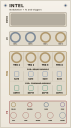

# Grandsummoner Intel

> **14 HP Modulation Matrix, Dual Paged FX Engine & Metering Ladder**

<p align="left">
  
</p>

---

## Overview

**Intel** is a 14 HP dual-purpose modulation and audio processing companion module for [VCV Rack v2](https://vcvrack.com/). Serving as the central nervous system of the Grandsummoner family, Intel combines a stereo delay-into-reverb multi-FX processor (with octave shimmer bloom), a high-resolution LED metering ladder, and four rhythmic LFO/trigger channels.

Intel is designed to operate as both a flexible standalone effects unit and an invisible expander hub. When placed beside **Spaces Command** and **Beams**, Intel establishes a bidirectional multi-hop communication link: it clocks its trigger divisions directly to Beams' Euclidean groove, modulates Spaces Command's generative parameters without a single patch cable, and provides macro control over Beams' drum decays.

---

## The Grandsummoner Module Family

Intel binds together the **Grandsummoner Eurorack Family**, providing spatial processing and cross-module synchronization:

| Module | Width | Primary Function | Role in Ecosystem |
| :--- | :--- | :--- | :--- |
| **Spaces Command** | 38 HP | Dual-Scene Probabilistic CV/Gate Sequencer & Arpeggiator | Master Composition & Clock Brain |
| **Beams** | 18 HP | Quad Algorithmic Euclidean Drum Engine & Sampler | Rhythm, Percussion & Clock Sync |
| **Stellar** | 14 HP | Dual-Voice Multi-Model Synthesizer Companion | Primary Melodic & Harmonic Voice |
| **Intel** | 14 HP | Modulation Matrix, Dual FX Engine & Metering Ladder | Utility, Inter-Module Modulation & Modulation Router |
| **Explorer** | 12 HP | Tape-Cloud Delay, Diffusion Reverb & Octave Shimmer | Master Spatialization, Diffusion & Ambient Textures |

### Shared Design Language
Every Grandsummoner module follows an authentic studio instrument aesthetic:
- **Warm Sand Cards** (`#F5F1E9` down to `#EDE7DC`) framed by precision `0.4–0.5pt` bronze perimeter cards (`#8A7F6A`).
- **Deep Obsidian Knobs** with ivory indicator lines (`#E8E0D0`).
- **Dual Visual Meters**: Hardware-accurate multi-segment stereo VU ladder (calibrated to 0 dB = ±10V peak).
- **Tactile Paged Selection Buttons**: Instant knob snapping with persistent underlying engine states.

### Standalone vs. Family Operation

- **100% Standalone**: Intel is fully functional in any Eurorack patch. Feed any modular stereo source into `EXT L/R`, dial in delay and shimmer reverb, and patch the four `TRIG 1–4` outputs to drive envelopes, drum modules, or clock inputs.
- **Universal Adjacency Link**: Side connector LEDs (`LINK L` and `LINK R`) light up whenever Intel sits adjacent to any Grandsummoner family module (**Spaces Command**, **Beams**, **Stellar**, or **Explorer**).

### Cross-Module Synergies & Expander Bus
- **With Spaces Command (Invisible Modulation)**:
  - When placed adjacent (or along a contiguous module chain), Intel's four LFO channels directly modulate Command's core parameters without patch cables:
    - **Channel 1** modulates **RATE** (speed of the sequencer, with floor protection against stalling).
    - **Channel 2** modulates **DENSITY** (probability of hits).
    - **Channel 3** modulates **SWING** (groove micro-timing).
    - **Channel 4** modulates **ENTROPY** (pattern randomness and drift).
- **With Beams (Clock Locking & Macro Decay)**:
  - **Clock Sync**: Beams sends clock ticks across the expander link. Intel automatically detects these ticks and locks its `TRIG 1–4` divisions to Beams' master tempo grid.
  - **Macro Decay**: Intel's `TONE` knob simultaneously acts as a master decay modifier for all four Beams drum tracks.
- **With Stellar & Explorer**: Process Stellar's raw voices through Intel's delay-into-reverb stage, or daisy-chain Intel into Explorer for multi-stage ambient diffusion.

---

## User Guide & Controls

```
┌───────────────────────────────────────────────────┐
│                    INTEL  14 HP                   │
│                                                   │
│  I/O:   (EXT L)    (EXT R)    [OUT L]   [OUT R]   │
│         stereo in   stereo in  fx out    fx out   │
│                                                   │
│  FX ENGINE                                        │
│  [DELAY]   [REVERB]   [SHIMMER]   [SYNC]          │
│   page      page       pitch       clock sync     │
│  [MIX]     [TIME]     [REGEN]     [TONE]          │
│   dry/wet   time/size  feedback    damping/decay  │
│                                                   │
│  MODULATION & TRIGGERS                            │
│  [SPEED]   (TRIG 1)   (TRIG 2)    (TRIG 3) (TRIG 4│
│   lfo rate  rate mod   dens mod    swng mod entr  │
│  [DIV 1]   [DIV 2]    [DIV 3]     [DIV 4]         │
│  [DEPTH 1] [DEPTH 2]  [DEPTH 3]   [DEPTH 4]       │
└───────────────────────────────────────────────────┘
```

### 1. Audio I/O & Metering (Top Card)
- **EXT L / EXT R Inputs**: Stereo audio inputs for processing external instruments. If `EXT R` is unpatched, mono audio normalled to both channels.
- **MASTER L / MASTER R Outputs**: Main low-impedance stereo wet/dry mix outputs.
- **VU Metering Ladder**: Multi-segment stereo peak level meters monitoring Intel's master output post-effects. Calibrated to modular audio levels (0 dB = ±10V peak).

### 2. Dual Paged FX Engine (Middle Card)
Both the stereo delay and algorithmic reverb run continuously in series (`Delay → Reverb`). The shared knobs dynamically map to whichever effect page is active:

- **DELAY / REVERB Page Buttons**: Switches knob focus between the Delay and Reverb engines. Toggling pages does **not** reset the other effect's settings.
- **SHIMMER Button**: Activates the octave-up granular pitch-shift engine inside the reverb tank.
- **SYNC Button**: Quantizes delay time to rhythmic divisions of the incoming clock.
- **MIX (0% – 100%)**: Sets dry/wet blend for the active page.
- **TIME (0% – 100%)**: Controls delay time (10 ms to 2.0 s) or reverb room size / pre-delay.
- **REGEN (0% – 100%)**: Controls delay feedback repeats or reverb tail decay length.
- **TONE (0% – 100%)**: High-frequency absorption / damping filter. When linked to Beams, also applies an additive decay offset across all drum tracks.

### 3. Modulation & Trigger Channels (Bottom Card)
- **SPEED (0.05 Hz – 4.0 Hz)**: Sets master LFO rate when free-running. Automatically bypassed when locked to Beams' clock ticks.
- **TRIG 1 – TRIG 4 Outputs**: Dedicated gate trigger pulse jacks (0 to +10V) outputting rhythmic subdivisions.
- **RATE-DIV Buttons (1–4)**: Cycles the trigger division:
  - With Beams linked: **Every 8th / 4th / 2nd / Every tick**.
  - Free-running: Divides the master SPEED oscillator.
- **DEPTH Buttons (1–4)**: Cycles modulation depth sent to Spaces Command through the invisible expander bus:
  - `0` = Off (no modulation)
  - `1` = Low (subtle drift)
  - `2` = Medium (musical groove variation)
  - `3` = High (dramatic pattern mutation)

---

## Technical Specifications

- **Width**: 14 HP (71.12 mm)
- **Height**: 3U (128.5 mm physical standard / bit-for-bit 380px VCV grid height)
- **Depth**: 28 mm
- **Internal DSP**: 64-bit floating point processing
- **LFO Frequency**: 0.05 Hz to 4.0 Hz (free-running)
- **Trigger Pulse**: +10V, 10 ms pulse width
- **Audio Dynamic Range**: > 108 dB

---

## License

This software is released under the **GNU General Public License v3.0 or later** (GPL-3.0-or-later).  
Copyright © 2026 Grandsummoner. All rights reserved.
